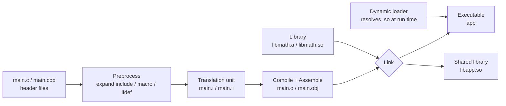

# C/C++ Compilation and Linking

This note covers the build pipeline that C and C++ share, plus the parts people often mix up: the preprocessor, translation units, linkage, the ODR, and library boundaries. For language topics (types, memory, object lifetime), see the [C notes](../C/README.md) and the [C++ notes](../CXX/README.md). CMake basics and Modern CMake are in [01](01_gcc_gxx_cmake_basics.md) and [02](02_modern_cmake.md).

Every shell snippet below comes from a lab in [examples/](examples/). The output shown is what the repo's Docker toolchain prints (Ubuntu 24.04, gcc 13.3, binutils 2.42, x86_64). Addresses and temporary paths change from run to run.

## 1. From source code to executable



Each `.c`/`.cpp` file is preprocessed and compiled on its own. Only the linker sees all the objects together and resolves symbols across files:

```sh
# C; for C++ use g++ (or clang++) the same way
gcc -E main.c -o main.i      # preprocess only
gcc -S main.i -o main.s      # compile to assembly
gcc -c main.s -o main.o      # assemble to an object file (no linking)
gcc -c add.c -o add.o
gcc main.o add.o -o app      # the linker combines objects and libraries
./app
```

C++ equivalent:

```sh
g++ -E main.cpp -o main.ii
g++ -c main.cpp -o main.o
g++ main.o add.o -o app
```

> Run it: `make shell`, then `bash markdowns/Compile/examples/pipeline/lab.sh` (CTest: `compile_pipeline_lab`). The lab prints every command before it runs it.

What each stage leaves behind (from the lab; `main.c` calls `add()` through a `TWICE()` macro):

```text
$ gcc -E main.c -o main.i
$ grep -c "" main.i      # line count: <stdio.h> was pasted in
824
$ tail -n 4 main.i      # TWICE() is gone: macros are expanded
int main(void) {
    printf("%d\n", ((add(2, 3)) * 2));
    return 0;
}
$ gcc -S main.i -o main.s
$ grep call main.s
	call	add@PLT
	call	printf@PLT
$ gcc -c main.s -o main.o
$ nm main.o
                 U add
0000000000000000 T main
                 U printf
$ gcc -c add.c -o add.o
$ nm add.o
0000000000000000 T add
$ gcc main.o add.o -o app
$ ./app
10
```

`U` means "used here, defined somewhere else". The linker's job is to find a `T` (defined in text) for every `U`.

### What does each stage do?

| Stage | Input/output | Main work | Typical errors |
|---|---|---|---|
| Preprocess | `.c` → `.i`, `.cpp` → `.ii` | Expand `#include`, macros, conditional compilation | Header not found, bad macro expansion |
| Compile | translation unit → assembly | Syntax, types, templates, language rules | Syntax error, type mismatch |
| Assemble | assembly → object | Machine code plus relocation entries | Bad assembly, ABI mismatch |
| Link | objects + libraries → binary | Resolve symbols, apply relocations, write the executable | `undefined reference`, `multiple definition` |
| Load | binary + shared libraries | Load `.so`/`.dll` files at run time and bind dynamic symbols | Shared library not found, ABI mismatch |

`#include` is text pasting, not separate compilation. If two `.c` files include the same header, the header becomes part of two different translation units. That is why "may this definition appear in a header?" is the core question of linkage and the ODR.

## 2. C vs C++ at compile and link time: a gcc/g++ demo

The commands above use `gcc` and `g++` the same way, so C and C++ seem to share one pipeline. They do, but C++ does more work because of its language design (overloads, namespaces, exceptions, a runtime library). You can see the differences in the object file symbols and in the final link command.

### 2.1 Compile stage: name mangling

Two nearly identical source files:

```c
/* add.c */
int add(int a, int b) {
    return a + b;
}
```

```cpp
// add.cpp
int add(int a, int b) {
    return a + b;
}
```

Compile each with its own compiler and look at the symbol table with `nm`:

```text
$ gcc -c add.c -o add_c.o
$ g++ -c add.cpp -o add_cpp.o
$ nm add_c.o
0000000000000000 T add
$ nm add_cpp.o
0000000000000000 T _Z3addii
```

In C, the symbol is the plain name `add`. In C++, it is mangled to `_Z3addii` (Itanium C++ ABI: `_Z`, name length 3, `add`, parameters `i`/`i` = `int, int`). The parameter types are part of the symbol, which is how overloads, namespaces, and templates can share a name:

```text
$ nm overload.o
0000000000000018 T _Z3adddd
0000000000000000 T _Z3addii
$ nm -C overload.o
0000000000000018 T add(double, double)
0000000000000000 T add(int, int)
$ c++filt _Z3adddd
add(double, double)
```

Mangling happens at **compile** time, not in the linker. But it is the root cause of every C/C++ interop problem at link time. A C caller asks for `add`, and a C++ object only offers `_Z3addii`:

```text
$ gcc main.o add_cpp.o -o app_mangled    # expected to fail
/usr/bin/ld: main.o: in function `main':
main.c:(.text+0x13): undefined reference to `add'
collect2: error: ld returned 1 exit status
```

To keep the C name for a function written in C++ (for example, so C code can call it), declare it `extern "C"`:

```cpp
// add_c_linkage.cpp
extern "C" int add(int a, int b) {
    return a + b;
}
```

```text
$ g++ -c add_c_linkage.cpp -o add_c_linkage.o
$ nm add_c_linkage.o
0000000000000000 T add
$ gcc main.o add_c_linkage.o -o app_extern_c
$ ./app_extern_c
10
```

With `extern "C"`, the symbol is plain `add` again, even though `g++` compiled it. Now `main.c` can call it with an ordinary `int add(int, int);` declaration.

### 2.2 Link stage: gcc and g++ add different libraries

A program that uses the C++ standard library:

```cpp
// hello.cpp
#include <iostream>

int main() {
    std::cout << "Hello from C++\n";
    return 0;
}
```

Compile it once, then use `gcc` and `g++` as the link driver:

```text
$ g++ -c hello.cpp -o hello.o
$ gcc hello.o -o app_gcc    # expected to fail
/usr/bin/ld: hello.o: warning: relocation against `_ZSt4cout' in read-only section `.text'
/usr/bin/ld: hello.o: in function `main':
hello.cpp:(.text+0x15): undefined reference to `std::cout'
/usr/bin/ld: hello.cpp:(.text+0x1d): undefined reference to `std::basic_ostream<char, std::char_traits<char> >& std::operator<< <std::char_traits<char> >(std::basic_ostream<char, std::char_traits<char> >&, char const*)'
/usr/bin/ld: warning: creating DT_TEXTREL in a PIE
collect2: error: ld returned 1 exit status
$ g++ hello.o -o app_gxx
$ ./app_gxx
Hello from C++
```

(Older GCC versions also reported `std::ios_base::Init::Init()`. Since GCC 13, libstdc++ initializes the standard streams itself, so `<iostream>` no longer emits that call in every translation unit.)

`gcc` and `g++` run the same `collect2`/`ld` with the same startup files (`Scrt1.o`, `crti.o`, `crtbeginS.o`, ...). The difference is the library list the **driver** adds. In `g++ -v` the link line has `-lstdc++ -lm` and links `libgcc_s` (the shared unwinder) directly. `gcc` adds neither `-lstdc++` nor `-lm`, and links `libgcc_s` only `--as-needed`. If you add `-lstdc++` by hand, `gcc` can link the program:

```text
$ gcc hello.o -o app_gcc -lstdc++
$ ./app_gcc
Hello from C++
```

This works, but it is a manual patch. If the program needs `libm` or a static link (`-static`), you must also copy the rest of g++'s list. The convention is simple: **if any object is C++, link with `g++`** (CMake does this for you; see below).

### 2.3 Mixing C and C++ objects in one program

A C library header that both languages can include:

```c
/* add.h */
#ifndef ADD_H
#define ADD_H

#ifdef __cplusplus
extern "C" {
#endif

int add(int a, int b);

#ifdef __cplusplus
}
#endif

#endif
```

```cpp
// main.cpp
#include "add.h"

#include <iostream>

int main() {
    std::cout << "add(2, 3) = " << add(2, 3) << "\n";
    return add(2, 3) == 5 ? 0 : 1;
}
```

By hand:

```sh
gcc -c add.c    -o add.o       # compile C with gcc
g++ -c main.cpp -o main.o      # compile C++ with g++
g++ add.o main.o -o app        # link with g++
./app                          # add(2, 3) = 5
```

> Run it: `make run EX=compile_mixed_c_cxx` (source: [examples/mixed/](examples/mixed/)). CMake compiles `add.c` with the C compiler and `main.cpp` with the C++ compiler. Because the target contains C++, it links with `g++`.

Three points, matching the Compile and Link boxes in the diagram:

- **Compile**: each file uses its own language's compiler (`add.c` → gcc, `main.cpp` → g++), because syntax rules and name mangling differ.
- The `extern "C"` block in `add.h` makes `main.o` reference the plain symbol `add`, which `add.o` defines. The `#ifdef __cplusplus` guard hides `extern "C"` from the C compiler, which does not know that syntax.
- **Link**: use `g++` as the final driver even though `add.o` is pure C, because the program contains C++ and needs g++'s runtime libraries. CMake chooses the driver from the target's `LINKER_LANGUAGE`, which it computes from the source languages. In a mixed target, C++ wins.

## 3. Load stage: shared libraries and `dlopen`

Sections 1 and 2 stop at Link. The diagram shows Load as a separate stage: **at run time**, the dynamic loader (`ld.so`) finds the `.so` dependencies, maps them into memory, and binds symbols.

> Run it: `make shell`, then `bash markdowns/Compile/examples/libraries/lab.sh` (CTest: `compile_libraries_lab`).

### 3.1 What a shared library depends on: `NEEDED`

The `NEEDED` entries in the dynamic section list the libraries the loader must load. It is easy to assume that every C++ shared library depends on `libstdc++`, but on this toolchain that is **not** always true: Ubuntu's GCC passes `--as-needed` to the linker. A library gets a `NEEDED` entry only if it uses a symbol from that library:

```text
$ gcc -fPIC -shared add.c -o libadd_c.so
$ g++ -fPIC -shared add.cpp -o libadd_cpp.so
$ g++ -fPIC -shared greet.cpp -o libgreet.so
$ readelf -d libadd_c.so | grep NEEDED
(no NEEDED entries)
$ readelf -d libadd_cpp.so | grep NEEDED
(no NEEDED entries)
$ readelf -d libgreet.so | grep NEEDED
 0x0000000000000001 (NEEDED)             Shared library: [libstdc++.so.6]
 0x0000000000000001 (NEEDED)             Shared library: [libgcc_s.so.1]
 0x0000000000000001 (NEEDED)             Shared library: [libc.so.6]
$ ldd libgreet.so | sed "s/ (0x.*//"
	linux-vdso.so.1
	libstdc++.so.6 => /lib/x86_64-linux-gnu/libstdc++.so.6
	libgcc_s.so.1 => /lib/x86_64-linux-gnu/libgcc_s.so.1
	libc.so.6 => /lib/x86_64-linux-gnu/libc.so.6
	libm.so.6 => /lib/x86_64-linux-gnu/libm.so.6
	/lib64/ld-linux-x86-64.so.2
```

`add.cpp` only adds two ints, so nothing from libstdc++ is used (`ldd libadd_cpp.so` prints just `statically linked`, because the library has no dependencies at all). `greet.cpp` uses `std::string`, so it needs libstdc++ and the unwinder `libgcc_s`. `ldd` also shows indirect dependencies (`libm` comes from libstdc++), while `readelf -d` shows only the direct ones.

The real point: **C++ code that uses the standard library adds a run-time dependency on a compatible `libstdc++.so.6`**. If the target machine's libstdc++ is older than the one used at build time, loading fails with an error such as `version 'GLIBCXX_3.4.32' not found`. Pure C code never has this problem. A toolchain that does not pass `--as-needed` by default (for example, an upstream GCC built from source) adds `NEEDED libstdc++` to every library that g++ links.

### 3.2 `dlopen`/`dlsym`: easy in C, one extra step in C++

Loading a `.so` on demand and looking up a function **by name** shows most clearly that the Load stage depends on symbol names. The loader in [examples/dlopen/loader.c](examples/dlopen/loader.c) opens two plugins built from the same function, one without and one with `extern "C"`. The core of it:

```c
void *handle = dlopen(path, RTLD_NOW);
void *sym = dlsym(handle, "add");    /* look up by the plain name */
if (!sym) printf("%s\n", dlerror());
```

> Run it: `make run EX=compile_dlopen_loader`. CMake builds `libcompile_plugin_mangled.so` (from `add.cpp`) and `libcompile_plugin_extern_c.so` (from `add_c_linkage.cpp`) as `SHARED` targets next to the loader.

```text
-- ./libcompile_plugin_mangled.so (no extern "C")
dlsym("add"): ./libcompile_plugin_mangled.so: undefined symbol: add
dlsym("_Z3addii") found it: add(2, 3) = 5
-- ./libcompile_plugin_extern_c.so (extern "C")
dlsym("add") found it: add(2, 3) = 5
```

This matches the `nm` output in section 2.1: the C++ plugin exports `_Z3addii`, not `add`. You can pass the mangled name to `dlsym`, but that is fragile (it depends on the ABI and changes when the signature changes). The usual fix is an `extern "C"` entry point. Plugin systems often export one `extern "C"` factory function that returns a C++ object.

Other notes:

- Since glibc 2.34, `dlopen` is part of `libc`, so `-ldl` is no longer required (it still works). CMake's `${CMAKE_DL_LIBS}` handles both cases.
- ISO C does not allow converting `void *` to a function pointer. POSIX requires it to work for `dlsym`. With `-Wpedantic`, `int (*fn)(int, int) = dlsym(...)` causes a warning, so the example copies the pointer with `memcpy`.
- A path that contains `/` (such as `./libfoo.so`) makes `dlopen` open that file directly. A plain name (`libfoo.so`) is searched like a `NEEDED` entry (see 3.3).

### 3.3 Link succeeds, load fails

The linker found everything, so the executable was written. But it records only the library **name** (`NEEDED libadd_c.so`), not where the library was found:

```text
$ gcc main.c -L. -ladd_c -o app_shared
$ readelf -d app_shared | grep NEEDED
 0x0000000000000001 (NEEDED)             Shared library: [libadd_c.so]
 0x0000000000000001 (NEEDED)             Shared library: [libc.so.6]
$ ./app_shared    # expected to fail
./app_shared: error while loading shared libraries: libadd_c.so: cannot open shared object file: No such file or directory
```

This is purely a Load error. `-L.` only told the **linker** where to look. The dynamic loader searches `LD_LIBRARY_PATH`, the binary's `RUNPATH`, the `ldconfig` cache, and the default directories (`/lib`, `/usr/lib`). It never searches the current directory. The compiler (gcc or g++) has nothing to do with it. The fix is to tell the loader where to look:

```text
$ LD_LIBRARY_PATH=. ./app_shared            # option 1: environment (for testing, not for deployment)
add(2, 3) = 5
$ gcc main.c -L. -ladd_c -Wl,-rpath,'$ORIGIN' -o app_rpath    # option 2: record a path in the binary
$ readelf -d app_rpath | grep -E "RPATH|RUNPATH"
 0x000000000000001d (RUNPATH)            Library runpath: [$ORIGIN]
$ ./app_rpath
add(2, 3) = 5
```

`$ORIGIN` means "the directory of this binary", so the program and its libraries can move together. Ubuntu's linker uses `--enable-new-dtags` by default, so `-rpath` writes `RUNPATH`, not the older `RPATH`. The difference: `LD_LIBRARY_PATH` is searched **before** `RUNPATH` but **after** `RPATH`, and `RUNPATH` applies only to the binary's own direct dependencies. For how CMake sets these paths, see [01, section 4](01_gcc_gxx_cmake_basics.md#4-every-stage-side-by-side-gccg-vs-cmake) and the `compile_cmake_rpath_lab`.

Summary: the gcc/g++ difference at Link is "who adds `-lstdc++`". At Load, the question is "can the target environment find, at a compatible version, every library recorded at link time?" C++ code that uses the standard library has one more such dependency (libstdc++), so Load failures are more likely than with pure C. That is why the diagram draws Link and Load as separate boxes.

## 4. Linkage in C

### `static`, `extern`, and `inline`

| Declaration | Language | Meaning |
|---|---|---|
| File-scope `static` function/variable | C, C++ | Internal linkage. Each translation unit has its own entity. Other files cannot refer to it. |
| File-scope definition without `static` | C, C++ | Usually external linkage. Other translation units can use it through a declaration. (A variable without an initializer is a *tentative definition*; see below.) |
| `extern` | C, C++ | Declares an external symbol that another translation unit defines. Usually allocates no storage. |
| File-scope `const` variable (no `extern`/`static`) | C | External linkage, like any other global variable. |
| File-scope `const` variable (no `extern`/`static`) | C++ | Internal linkage (as if `static`): one private copy per TU. The opposite of C. |
| `static inline` function | C | Each translation unit keeps its own internal-linkage helper. Good for C headers. |
| `inline` function | C | Follows C's own inline-definition rules. GNU89 and C99 give `inline`/`extern inline` opposite meanings. Do not apply C++ ODR rules (see below). |

A safe pattern for C headers:

```c
/* math_helpers.h */
#ifndef MATH_HELPERS_H
#define MATH_HELPERS_H

static inline int twice(int value) {
    return value * 2;
}

#endif
```

With `static inline`, each translation unit has its own internal-linkage helper, so many files can include the header without duplicate external symbols. `inline` only lets the compiler consider inlining. It does not guarantee that the call is expanded.

### A definition in a header: `multiple definition`

> Run it: `make shell`, then `bash markdowns/Compile/examples/linkage/lab.sh` (CTest: `compile_linkage_lab`).

```c
/* counter_bad.h - included by use_a.c and use_b.c */
int counter = 0;
```

```text
$ nm use_a.o
0000000000000000 B counter
0000000000000000 T read_a
$ gcc use_a.o use_b.o -o app_counter    # expected to fail
/usr/bin/ld: use_b.o:(.bss+0x0): multiple definition of `counter'; use_a.o:(.bss+0x0): first defined here
collect2: error: ld returned 1 exit status
```

Each object has its own external definition (`B` = defined in `.bss`). Fix: `extern int counter;` in the header and `int counter = 0;` in exactly one `.c` file.

### `const` globals: C and C++ do the opposite

This C/C++ difference is easy to miss, and it often causes problems in headers:

```c
/* config.h: a trap in C */
const int MAX = 100;   /* every .c that includes this header gets an external definition */
```

```text
$ gcc -c config_a.c -o config_a.o
$ nm config_a.o
0000000000000000 R MAX
0000000000000000 T max_a
$ gcc config_a.o config_b.o -o app_config_c    # expected to fail
/usr/bin/ld: config_b.o:(.rodata+0x0): multiple definition of `MAX'; config_a.o:(.rodata+0x0): first defined here
collect2: error: ld returned 1 exit status
$ g++ -x c++ -c config_a.c -o config_a_cpp.o
$ nm config_a_cpp.o
0000000000000000 T _Z5max_av
0000000000000000 r _ZL3MAX
$ g++ config_main.cpp config_a_cpp.o -o app_config_cpp
$ ./app_config_cpp
same object: no
```

In C, `MAX` is a global read-only symbol (`R`), so two includers clash. Compiled as C++, it is local (`r`, and `_ZL` marks internal linkage). Every TU has a private copy, so the link succeeds, but `&MAX` differs between TUs.

To put a constant in a C header:

```c
static const int MAX = 100;      /* one copy per TU, like the C++ default */
/* or */
extern const int MAX;            /* declaration in the header */
/* plus, in exactly one .c file: const int MAX = 100; */
```

Since C++17, `inline constexpr` makes the whole program share one entity (the same mechanism as C++17 `inline` variables below):

```cpp
// config.h, C++17+
inline constexpr int MAX = 100;   // included by many .cpp files, still one entity
```

The same mechanism works for `static` data members in a class, so you no longer need an extra definition in a `.cpp` file:

```cpp
struct Config {
    inline static int counter = 0;  // C++17: ODR-safe, no out-of-class definition needed
};
```

### Tentative definitions and `-fno-common`

The table row "file-scope definition without `static`" has one more detail for variables:

```c
/* tentative_a.c */
int shared_flag;   /* tentative definition: no initializer */

/* tentative_b.c */
int shared_flag;   /* another tentative definition */
```

In ISO C, two external definitions of the same name in different TUs are undefined behavior. Traditional Unix linkers merged them anyway ("common symbols"; ISO C lists this as a common extension in Annex J.5.11), so this code linked under GCC for decades. **GCC 10 (2020) changed the default from `-fcommon` to `-fno-common`**, and now it fails to link:

```text
$ nm tentative_a.o
0000000000000000 T get_flag
0000000000000000 B shared_flag
$ gcc tentative_a.o tentative_b.o -o app_tentative    # expected to fail
/usr/bin/ld: tentative_b.o:(.bss+0x0): multiple definition of `shared_flag'; tentative_a.o:(.bss+0x0): first defined here
collect2: error: ld returned 1 exit status
$ gcc -fcommon -c tentative_a.c -o tentative_a.o
$ gcc -fcommon -c tentative_b.c -o tentative_b.o
$ nm tentative_a.o
0000000000000000 T get_flag
0000000000000004 C shared_flag
$ gcc tentative_a.o tentative_b.o -o app_tentative
```

With `-fcommon` the symbol becomes `C` (common), and the linker merges the copies. Old C projects (especially embedded and kernel-related code) often hit this error after a toolchain upgrade. The right fix is an `extern` declaration in the header and one definition in one TU, not `-fcommon`.

### GNU89 and C99 give `inline` opposite meanings

The `inline` row is worth a closer look. **GCC's traditional GNU89 inline semantics and ISO C99 inline semantics swap the meanings of `inline` and `extern inline`:**

- **C99**: a plain `inline` definition (no `extern`) emits no externally visible symbol. It is only an inline candidate. If a call is not inlined, it needs an external definition. You provide that in exactly one TU by adding a declaration with `extern` (or without `inline`) next to the inline definition. That TU then emits the external definition.
- **GNU89** (`-std=gnu89`, the GCC default before GCC 5): roughly the reverse. `extern inline` means "inline only, no external symbol", and a plain `inline` emits an external symbol in **every** TU that defines it. A header with a plain `inline` function included in several files then gives multiple definitions.

This is why old glibc and Linux kernel headers use `extern inline` on purpose (today usually with `__attribute__((gnu_inline))` to keep the GNU89 meaning). With a newer compiler that defaults to C99/C11 semantics, the meaning changes and causes link errors or different behavior. The safe practice: **use `static inline` for small functions in headers** (it behaves the same under both rules). If you really need one shared external inline function across TUs, set the standard explicitly (`-std=c99`, `-std=gnu11`, ...) and know which rules apply.

### The limits of C macros

Macros are text replacement in the preprocessor. They have no type, scope, or linkage, so they ignore all of the linkage rules above, and they also get no type checking. Arguments can be evaluated more than once:

```c
#define SQUARE(x) ((x) * (x))  /* SQUARE(i++) increments i twice: undefined behavior */
```

Prefer `enum`, `const`, functions, or `static inline`, which are type-checked. (More on the preprocessor in [C qualifiers and preprocessor](../C/04_qualifiers_and_preprocessor.md).) Wrap a multi-statement macro in `do { ... } while (0)` so that it acts as one statement:

```c
#define LOG_ERROR(msg) log_msg(msg); increment_error_count()

if (cond)
    LOG_ERROR("oops");   /* expands to two statements: the if ends after log_msg(...) */
else                     /* gcc: error: 'else' without a previous 'if' */
    do_something();
```

Without the `else`, the code compiles, and `increment_error_count()` always runs, outside the `if`. The fixed version:

```c
#define LOG_ERROR(msg) do { log_msg(msg); increment_error_count(); } while (0)
```

## 5. The C++ ODR and `inline`

### One Definition Rule

The ODR (One Definition Rule) says that some entities must have exactly one definition in the whole program. The typical mistake is a plain non-`inline` global variable or function definition in a header. Then every `.cpp` that includes it emits an external definition:

```cpp
// bad.h
int global_counter = 0;          // included by several .cpp files: multiple definition
int helper() { return 42; }      // same ODR violation
```

The fix depends on what you need:

```cpp
// good.h
extern int global_counter;
inline int helper() { return 42; }
```

```cpp
// good.cpp
int global_counter = 0;
```

C++ `inline` is not just "please inline the machine code". It allows the same definition to appear in several translation units, as long as all the definitions are identical (the ODR). Since C++17, `inline` also applies to variables:

```cpp
// config.h, C++17+
inline int global_counter = 0;    // included by many .cpp files, still one entity
```

Do not treat C `static inline` and C++ `inline` as the same thing:

| Situation | Result |
|---|---|
| `static inline` in a C header | One internal-linkage helper per translation unit |
| `inline` in a C++ header | All translation units share one entity; the definitions must follow the ODR |
| Plain global definition in a C/C++ header | Usually multiple definitions; use `extern` plus one definition in a source file |
| Visible only in the current source file | File-scope `static` or a C++ unnamed namespace (both give internal linkage since C++11; see below) |

You can see the difference in the symbol table. [examples/linkage/helpers.h](examples/linkage/helpers.h) defines one `static` and one `inline` function, each with a local `static` counter:

```cpp
static int next_static() { static int n = 0; return ++n; } // one copy per TU
inline int next_inline() { static int n = 0; return ++n; } // one copy per program
```

```text
$ g++ -c helpers_a.cpp -o helpers_a.o
$ nm -C helpers_a.o
000000000000001f T call_from_a()
0000000000000000 W next_inline()
0000000000000000 t next_static()
0000000000000000 u next_inline()::n
0000000000000000 b next_static()::n
$ g++ helpers_main.cpp helpers_a.o -o app_helpers
$ ./app_helpers
static: 1, inline: 2
```

`next_inline` is a weak symbol (`W`), and its counter is a unique global (`u`), so the linker keeps one copy of each. `next_static` and its counter are local (`t`, `b`), so each TU has its own copy. Both TUs called each function once. The `static` counters each reached 1, and the shared `inline` counter reached 2.

### Implicitly `inline`

Besides the `inline` keyword, some C++ definitions are **implicitly inline** and get the same ODR exemption:

- A member function defined inside the class definition is implicitly `inline`, even without the keyword. Headers can contain such definitions safely.
- Implicit instantiations of function templates and class templates. If several TUs instantiate the same specialization, and each TU sees the same template definition (the ODR), the compiler and linker merge them with the same mechanism as inline functions (weak symbols / COMDAT groups). There is no multiple definition. Note: templates are not "inline" in the language sense; they have their own ODR rule with the same effect.
- `constexpr` functions, and `constexpr` static data members (since C++17).

```cpp
// widget.h
class Widget {
public:
    int value() const { return value_; }   // implicitly inline
private:
    int value_ = 0;
};

template <typename T>
T max_of(T a, T b) { return a > b ? a : b; }  // may appear in many TUs, like inline
```

### Local `static` variables in functions

The lab above shows this: if a `static` function has one copy per translation unit, each copy has its own local `static` variables. The local `static` variables of a C++ `inline` function belong to the one inline entity, so the whole program shares them. This matters when the function keeps state or a cache.

### Unnamed namespaces: before and after C++11

The table says "file-scope `static` or an unnamed namespace". Strictly, the two have the same linkage only since C++11:

- **Before C++11**: names in an unnamed namespace had *external* linkage. The namespace got a unique name per TU, so other TUs could not refer to them in practice. This was an advantage. C++03 did not allow entities with internal linkage (such as `static` functions) as template arguments, and unnamed-namespace members were allowed. That is why C++03 deprecated namespace-scope `static` in favor of unnamed namespaces.
- **Since C++11**: names in an unnamed namespace have internal linkage, the same as file-scope `static`. The template-argument restriction is gone too, and the deprecation of `static` was removed.

One difference remains: an unnamed namespace can also contain types (classes, enums), and `static` cannot apply to them. In modern C++, prefer the unnamed namespace for file-local helpers. Both forms are fine for functions and variables.

## 6. The C/C++ ABI boundary

C++ mangles function names. A C library that C++ code will call should declare its API `extern "C"` in the header:

```c
/* api.h */
#ifdef __cplusplus
extern "C" {
#endif

int library_init(void);

#ifdef __cplusplus
}
#endif
```

This only handles the symbol name and the C language linkage. It does not let C use C++ classes, templates, overloads, or exceptions. A cross-language API must use types that both languages can express (the C ABI), and it must state clearly who allocates and who frees memory.

### No overloading under `extern "C"`

Name mangling is off, so two `extern "C"` functions in the same scope cannot be overloads. The linker would see the same plain name:

```cpp
extern "C" {
    void process(int x);
    void process(double x);   // g++: error: conflicting declaration of C function 'void process(double)'
}
```

### `extern "C"` is not full ABI compatibility

`extern "C"` guarantees that the name is not mangled and that the function uses the C calling convention. It does **not**:

- Let C use C++ classes, templates, overloads, or exceptions.
- Guarantee that a struct has the same memory layout in both languages in every case. Standard-layout structs are fine on normal platforms. Bit-fields, non-default packing/alignment, or mixed compiler versions still need care.
- Make it safe for an exception to cross the boundary. **A C++ exception must not leave an `extern "C"` function that C code calls.** C frames usually have no unwind information (unless compiled with `-fexceptions`), so the program calls `std::terminate` or behaves in an undefined way. Catch everything inside the function with `try/catch` and return an error code or status. (See [C++ casts and exceptions](../CXX/05_casts_and_exceptions.md).)

```cpp
// api.cpp - the C++ implementation of library_init() from api.h
extern "C" int library_init(void) {
    try {
        // ... C++ code that may throw ...
        return 0;
    } catch (...) {
        return -1;   // never let the exception reach the C caller
    }
}
```

### Callback function pointers need matching linkage too

If a C API takes a function pointer as a callback, declare the C++ callback `extern "C"`:

```c
/* c_api.h */
typedef void (*callback_t)(int);
void register_callback(callback_t cb);
```

```cpp
// C++ caller
extern "C" void my_callback(int code) {   // C language linkage, like callback_t
    handle(code);
}
register_callback(my_callback);
```

In standard C++, language linkage is part of the function type. A pointer to a C++-linkage function and a pointer to an `extern "C"` function are different types. GCC and Clang ignore this difference (both use the same calling convention), so passing a non-`extern "C"` function compiles without a warning. Other compilers have rejected or warned about it, and a platform with different calling conventions would break. `extern "C"` keeps the code portable and states the intent.

## 7. Static libraries, shared libraries, and symbols

```sh
gcc -c add.c -o add.o
ar rcs libadd.a add.o                      # static library = archive of objects
gcc main.c -L. -ladd -o app_static         # the linker copies the needed objects

gcc -fPIC -shared add.c -o libadd_c.so     # shared library
gcc main.c -L. -ladd_c -Wl,-rpath,'$ORIGIN' -o app_rpath
```

From the libraries lab:

```text
$ ar t libadd.a
add.o
$ readelf -d app_static | grep NEEDED
 0x0000000000000001 (NEEDED)             Shared library: [libc.so.6]
```

`app_static` does not depend on `libadd` at run time. The code of `add.o` is inside the executable.

- **Static library (`.a`/`.lib`)**: at link time, the linker copies the needed object files into the binary. Deployment is simpler, but a library update needs a relink. Order matters: the linker only takes objects that resolve symbols that are **still undefined** at that point. Put `-ladd` after the objects that use it (`gcc -L. -ladd main.c` fails).
- **Shared library (`.so`/`.dll`)**: the binary keeps a dynamic dependency, and symbols are bound at load time. Processes can share the memory, and you can update the library alone. But you must manage search paths and ABI compatibility.
- **Visibility**: "it compiles" does not mean "it should be public". For a shared library, control the exported API explicitly (`-fvisibility=hidden` plus explicit exports). Otherwise internal symbols become part of your stable ABI.

Useful tools:

```sh
nm -C main.o                # symbols of an object; -C demangles C++ names
nm -D -C libplugin.so       # dynamic symbols of a shared library
readelf -Ws libplugin.so    # symbols with binding and visibility
readelf -d ./app            # NEEDED, RUNPATH, SONAME
ldd ./app                   # resolved shared-library dependencies (recursive)
```

When the linker fails, classify the error first:

- `undefined reference`: the definition was not linked, the library order is wrong, C++ mangling does not match (missing `extern "C"`), or the ABI/build options differ.
- `multiple definition`: a plain external definition exists in several objects. The common root cause is a non-`inline` global function or variable in a header (or a tentative definition under `-fno-common`).
- `cannot open shared object file` at run time: the dynamic loader cannot find the `.so`. Check `RUNPATH`/`RPATH`, `LD_LIBRARY_PATH`, and the system library cache (`ldconfig -p`).

## Further reading

- [gcc/g++ and CMake basics](01_gcc_gxx_cmake_basics.md): the command-line toolchain, a minimal CMake project, configure/build/install.
- [Modern CMake](02_modern_cmake.md): target-based CMake, dependencies, sanitizers, installing, and common traps.
- [Stack, heap, and object lifetime](../Memory/00_stack_heap_and_object_lifetime.md): storage duration and what happens at run time.

## Concept checks

1. What does `#include` produce? A larger translation unit (text pasting), not a separate library.
2. Why does a plain global definition in a header cause `multiple definition`? Every translation unit that includes it emits an external definition.
3. Are C `static inline` and C++ `inline` the same? No. C++ `inline` also carries the ODR rule that allows identical definitions in several translation units, and they are one entity.
4. Does `extern` allocate storage? A plain declaration does not. One source file must provide the definition.
5. What matters when C calls a C++ library? A C ABI with `extern "C"`, C-compatible types, no exceptions across the boundary, and clear ownership and lifetime rules.
6. What do you check first for `undefined reference`? Whether the symbol is really in an object/library (`nm`), the link order, name mangling, the ABI, and the build settings.
7. The program links but does not start: "cannot open shared object file". Why? Link-time `-L` does not affect the loader. Add a `RUNPATH` (`-Wl,-rpath,'$ORIGIN'`) or install the library in a system path.
